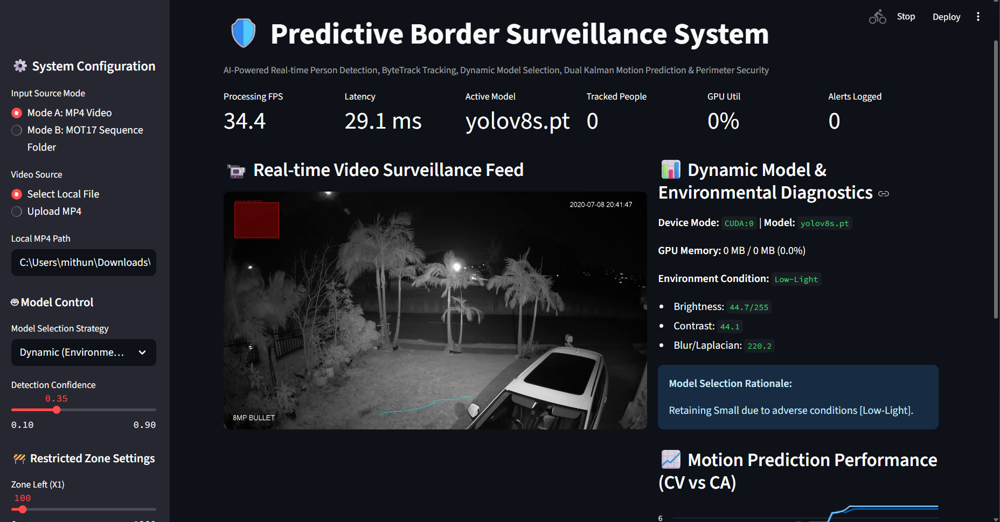
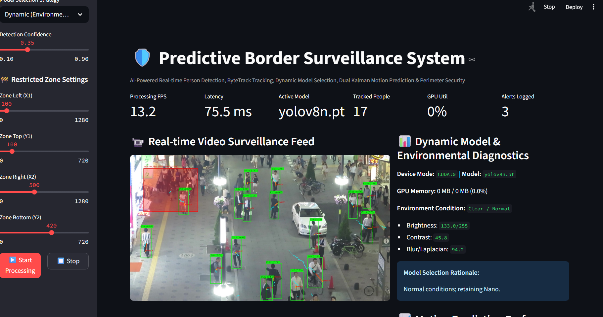

# Predictive Border Surveillance System

A computer-vision prototype for person detection and perimeter monitoring in video. It combines YOLOv8 detection, ByteTrack tracking, environmental analysis, adaptive model selection, motion prediction, and restricted-zone alerts.

## Features

- Process an MP4 video or a MOT17 sequence folder.
- Detect people and track them across frames with ByteTrack.
- Analyze brightness, contrast, blur, and GPU status.
- Select between YOLOv8 Nano and Small using environment and device conditions.
- Compare constant-velocity and constant-acceleration motion predictions.
- Define a restricted zone and log intrusion alerts.
- View live metrics and annotated video in the Streamlit dashboard, or run the command-line pipeline.

## Project layout

```text
.
├── alerts/          # Restricted-zone alerts
├── dashboard/       # Streamlit application
├── detection/       # YOLOv8 detector and model selection
├── environment/     # Video quality analysis
├── evaluation/      # MOT17 metrics and benchmarking
├── monitoring/      # GPU monitoring
├── prediction/      # Kalman motion prediction
├── tracking/        # ByteTrack tracking and trails
├── screenshots/     # Dashboard screenshots
├── config.py        # Settings and thresholds
├── main.py          # CLI pipeline
└── requirements.txt
```

## Setup

Use Python 3.10 or newer. Create and activate a virtual environment, then install the project dependencies:

```bash
python -m venv .venv
# Windows PowerShell
.venv\Scripts\Activate.ps1
# macOS/Linux: source .venv/bin/activate
python -m pip install --upgrade pip
pip install -r requirements.txt
```

Install the PyTorch build appropriate for your hardware by following the [official PyTorch installation guide](https://pytorch.org/get-started/locally/). The application uses CUDA when available and otherwise can run on CPU. The YOLOv8 weights (`yolov8n.pt` and `yolov8s.pt`) are not included; Ultralytics downloads a selected model when first needed.

## Run the dashboard

From the project root:

```bash
streamlit run dashboard/app.py
```

Choose **Upload MP4** in the sidebar, or enter a local video path. For MOT17, select the sequence-folder input and provide a folder containing `seqinfo.ini` and its configured image directory.

## Run the command-line pipeline

```bash
python main.py --input path/to/video.mp4 --no-display --output results/annotated.mp4
```

The input can also be a MOT17 sequence folder. Useful options include `--fixed-model yolov8n.pt` to disable dynamic model selection and `--max-frames 200` to limit processing.

## Screenshots

### Low-light diagnostics



### Person tracking and restricted zone



## Tests

The repository includes `test_all_stages.py` and `test_stage1.py`. The integrated tests exercise the detector and may download YOLO weights on first run. Run them after installing dependencies and enabling access to the required model weights:

```bash
python -m unittest test_all_stages.py
```
